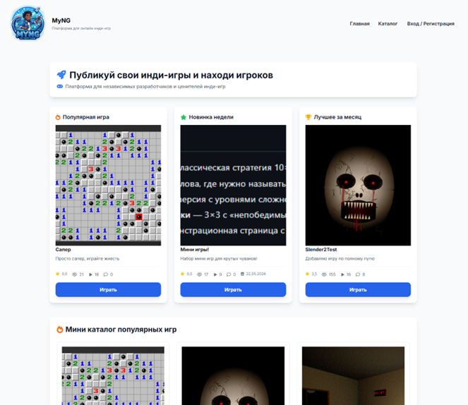
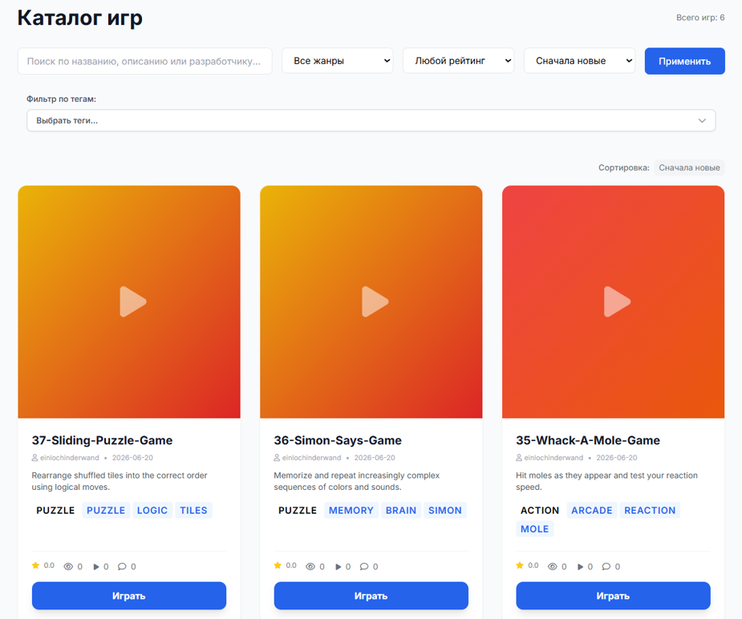
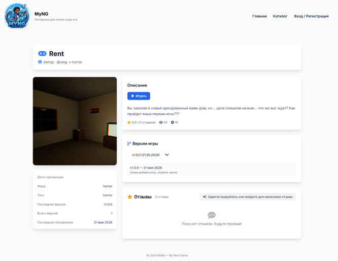
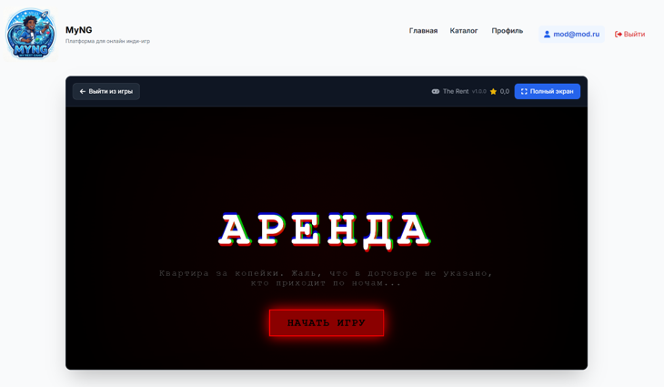
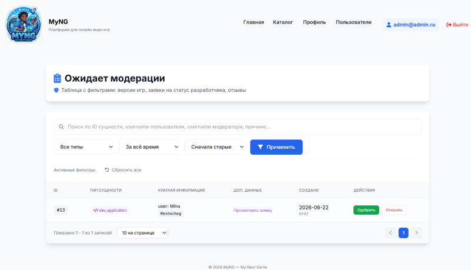
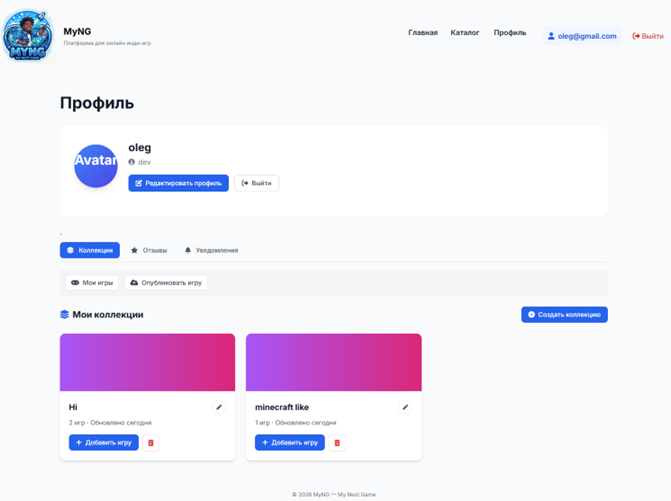

# 🎮 MYNG (My Next Game) — Платформа для размещения онлайн инди-игр

    

**MYNG** — full-stack веб-платформа для публикации, модерации и запуска браузерных инди-игр. Проект решает проблему поиска аудитории для начинающих разработчиков и предоставляет игрокам удобный каталог новых инди-проектов без необходимости скачивания сторонних лаунчеров.

> **Статус проекта:** находится в активной разработке. Планируется к защите в качестве выпускной квалификационной работы (ВКР).

---

## 🛠 Технологический стек

### Backend

- **Java 17 (LTS)**
- **Spring Boot 3.2.2** — Core, Web, Data JPA, Security, Validation
- **Spring WebFlux** — использование неблокирующего `WebClient` для интеграций
- **Lombok** — генерация boilerplate-кода
- **Maven** — сборка проекта

### База данных

- **MySQL 8.0** — основная реляционная СУБД
- **Hibernate / Spring Data JPA** — ORM, паттерн Repository

### Frontend

- **Thymeleaf** — Server-Side Rendering
- **Thymeleaf Security** — динамический рендеринг на основе ролей
- **Tailwind CSS** — утилитарный фреймворк для адаптивного UI
- **JavaScript (Fetch API)** — асинхронное взаимодействие с REST-эндпоинтами без перезагрузки страниц

### Тестирование

- **JUnit 5 & Spring Boot Test**
- **Mockito** — изоляция бизнес-логики
- **Testcontainers (MySQL)** — интеграционное тестирование на реальной СУБД в изолированной Docker-среде
- **WireMock** — эмуляция внешних HTTP-сервисов

---

## ✨ Основной функционал

Платформа поддерживает строгую ролевую модель:

`ROLE_PLAYER` · `ROLE_DEVELOPER` · `ROLE_MODERATOR` · `ROLE_ADMIN`

### 🕹️ Для игроков

- **Каталог и поиск:** динамические подборки («Популярное», «Новое», «Лучшее за месяц»), фильтрация и пагинация.
- **Геймплей:** запуск HTML5-игр прямо в браузере с возможностью выбора версии игры.
- **Социальные функции:** оценка проектов от 1 до 5, система отзывов, создание и управление личными коллекциями игр.
- **Профиль:** управление отзывами, просмотр уведомлений, например об изменении статуса модерации, подача заявки на получение статуса разработчика.

> Неавторизованный пользователь имеет доступ к играм и может запускать их, однако не имеет профиля и возможности оставлять отзывы.

### 👨‍💻 Для разработчиков

- **Публикация:** загрузка веб-сборок игр с хранением в локальном `/storage`, интеграция с GitHub.
- **Управление релизами:** загрузка обновлений, выбор активной версии, редактирование страницы игры.
- **Статистика:** отслеживание количества просмотров и запусков игр.

### 🛡️ Для модераторов и администраторов

- **Модерация:** очередь проверки новых игр, отзывов и заявок на получение статуса разработчика.
- **Администрирование:** журнал аудита действий модераторов, управление пользователями, смена ролей, блокировка, выдача предупреждений, поиск и фильтрация пользователей.

---

## 👨‍🔧 Моя роль в проекте

Изначально проект разрабатывался в команде из двух человек.

**Моя зона ответственности (Full-stack):**

- Проектирование и реализация страниц: главная страница, каталог с фильтрацией и пагинацией, страница игры.
- Разработка пользовательских функций: отзывы, коллекции и оценки.
- Разработка модуля управления пользователями (Admin Panel).
- Написание unit- и интеграционных тестов.

> После первых 175 коммитов я продолжил разработку проекта самостоятельно.

---

## 🚀 Как запустить проект локально

### 1. Клонирование репозитория

```bash
git clone https://github.com/Meshok54/Platform_for_hosting_online_indie_games.git
cd Platform_for_hosting_online_indie_games
```

### 2. Настройка переменных окружения

В корне проекта или в `src/main/resources` создайте файл `credentials.properties`.

> Файл `credentials.properties` добавлен в `.gitignore` и не должен попадать в репозиторий.

Пример содержимого:

```properties
spring.datasource.url=jdbc:mysql://localhost:3306/myng_db
spring.datasource.username=ваше_имя_пользователя
spring.datasource.password=ваш_пароль
github.token=ваш_токен_для_загрузки_игр
```

### 3. Настройка базы данных и хранилища

Убедитесь, что у вас запущен **MySQL** и создана база данных `myng_db`.

Скрипт создания базы данных находится в:

```text
docs/DB_scripts/create_sctipt_v0.0.0.sql
```

Папка `/storage`, предназначенная для локального хранения файлов игр, создаётся автоматически при загрузке первой игры.

### 4. Запуск приложения

Откройте проект в IDE (IntelliJ IDEA, VS Code или другой) и используйте Maven:

```bash
./mvn spring-boot:run
```

После запуска приложение будет доступно по адресу:

```text
http://localhost:8080
```

---

## Скриншоты интерфейса

### Главная страница



### Каталог игр



### Страница игры



### Запущенная игра



### Панель модерации



### Профиль пользователя


