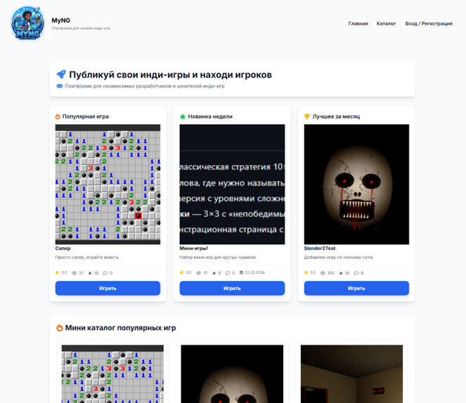
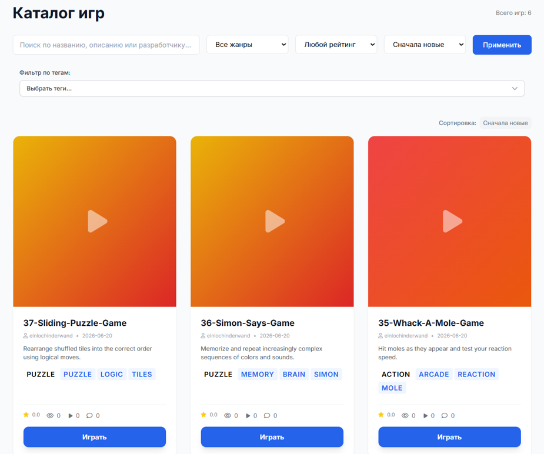
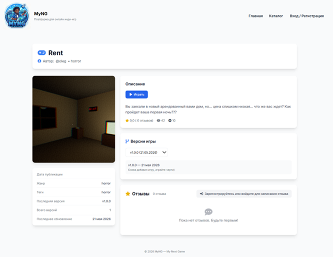
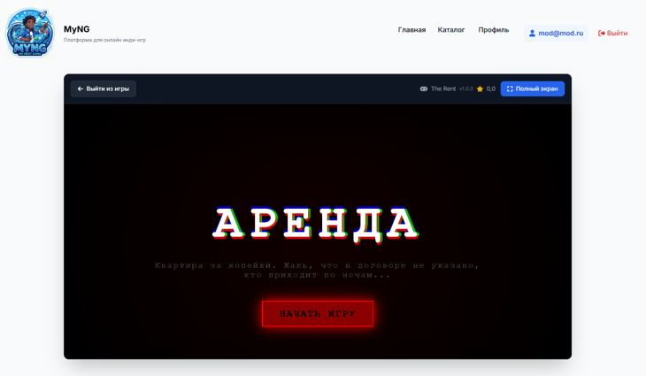
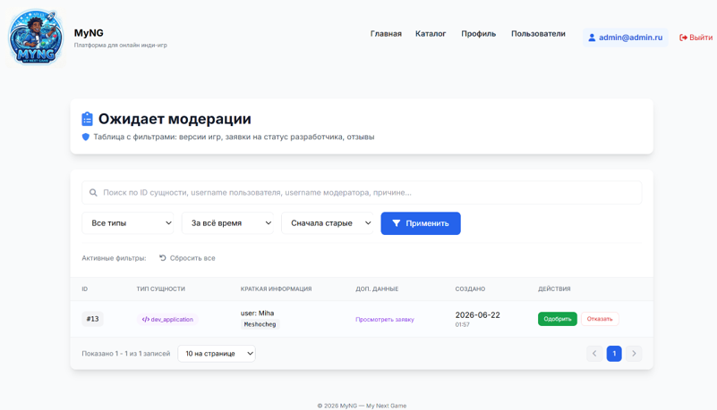
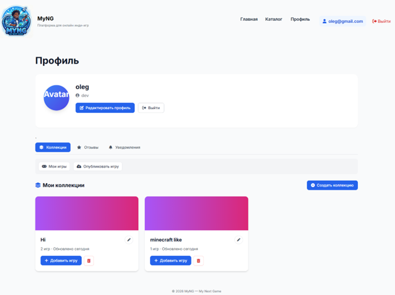

# 🎮 MYNG (My Next Game) — Платформа для размещения онлайн инди-игр

    

**MYNG** — full-stack веб-платформа для публикации, модерации и запуска браузерных инди-игр. Проект решает проблему поиска аудитории для начинающих разработчиков и предоставляет игрокам удобный каталог новых инди-проектов без необходимости скачивания сторонних лаунчеров.

> **Статус проекта:** находится в активной разработке. Планируется к защите в качестве выпускной квалификационной работы (ВКР).

---

## 🛠 Технологический стек

### Backend

- **Java 17 (LTS)**
- **Spring Boot 3.2.2** — Core, Web, Data JPA, Security, Validation
- **Spring WebFlux** — использование неблокирующего `WebClient` для интеграций
- **Lombok** — генерация boilerplate-кода
- **Maven** — сборка проекта

### База данных

- **MySQL 8.0** — основная реляционная СУБД
- **Hibernate / Spring Data JPA** — ORM, паттерн Repository

### Frontend

- **Thymeleaf** — Server-Side Rendering
- **Thymeleaf Security** — динамический рендеринг на основе ролей
- **Tailwind CSS** — утилитарный фреймворк для адаптивного UI
- **JavaScript (Fetch API)** — асинхронное взаимодействие с REST-эндпоинтами без перезагрузки страниц

### Тестирование

- **JUnit 5 & Spring Boot Test**
- **Mockito** — изоляция бизнес-логики
- **Testcontainers (MySQL)** — интеграционное тестирование на реальной СУБД в изолированной Docker-среде
- **WireMock** — эмуляция внешних HTTP-сервисов

---

## ✨ Основной функционал

Платформа поддерживает строгую ролевую модель:

`ROLE_USER` (игрок) · `ROLE_DEV` (разработчик) · `ROLE_MOD` (модератор) · `ROLE_ADMIN` (администратор)

### 🕹️ Для игроков

- **Каталог и поиск:** динамические подборки («Популярное», «Новое», «Лучшее за месяц»), фильтрация и пагинация.
- **Геймплей:** запуск HTML5-игр прямо в браузере с возможностью выбора версии игры.
- **Социальные функции:** оценка проектов от 1 до 5, система отзывов, создание и управление личными коллекциями игр.
- **Профиль:** управление отзывами, просмотр уведомлений, например об изменении статуса модерации, подача заявки на получение статуса разработчика.

> Неавторизованный пользователь имеет доступ к играм и может запускать их, однако не имеет профиля и возможности оставлять отзывы.

### 👨‍💻 Для разработчиков

- **Публикация:** загрузка веб-сборок игр с хранением в локальном `/storage`, интеграция с GitHub.
- **Управление релизами:** загрузка обновлений, выбор активной версии, редактирование страницы игры.
- **Статистика:** отслеживание количества просмотров и запусков игр.

### 🛡️ Для модераторов и администраторов

- **Модерация (модератор и администратор):** очередь проверки новых версий игр, отзывов с большим числом жалоб и заявок на получение статуса разработчика.
- **Администрирование (только администратор):** журнал аудита действий модераторов, управление пользователями, смена ролей, блокировка, выдача предупреждений, поиск и фильтрация пользователей.

### 🔒 Безопасность

- Разграничение доступа по ролям (Spring Security) и проверка владельца объектов: изменять отзывы, коллекции и версии игр может только их автор.
- Защита от CSRF: токен в формах и во всех изменяющих fetch-запросах, cookie сессии с `SameSite=Lax`.
- Изоляция игр: файлы игр раздаются с отдельного origin (отдельный порт), поэтому JavaScript игры не имеет доступа к сайту от имени игрока.
- Ограничения при скачивании игр из GitHub: размер архива, объём распаковки и число файлов (защита от zip-бомб), защита от Zip Slip.
- Единая обработка ошибок: клиенту не раскрываются внутренние сообщения и SQL-ошибки.

---

## 👨‍🔧 Моя роль в проекте

Изначально проект разрабатывался в команде из двух человек.

**Моя зона ответственности (Full-stack):**

- Проектирование и реализация страниц: главная страница, каталог с фильтрацией и пагинацией, страница игры.
- Разработка пользовательских функций: отзывы, коллекции и оценки.
- Разработка модуля управления пользователями (Admin Panel).
- Написание unit- и интеграционных тестов.

> После первых 175 коммитов я продолжил разработку проекта самостоятельно.

---

## 🚀 Как запустить проект локально

### 1. Клонирование репозитория

```bash
git clone https://github.com/Meshok54/Platform_for_hosting_online_indie_games.git
cd Platform_for_hosting_online_indie_games
```

### 2. Настройка учётных данных

Создайте файл `myng/src/main/resources/credentials.properties` (приложение читает его только из этого места).

> Файл `credentials.properties` добавлен в `.gitignore` и не должен попадать в репозиторий.

Пример содержимого:

```properties
spring.datasource.username=ваше_имя_пользователя_mysql
spring.datasource.password=ваш_пароль_mysql
github.token=ваш_токен_github
# необязательно: ключ для cookie «Запомнить меня»; если не задан, генерируется при каждом запуске
app.remember-me.key=любая_длинная_случайная_строка
```

Для `github.token` достаточно fine-grained токена с доступом только на чтение публичных репозиториев
(GitHub → Settings → Developer settings → Personal access tokens).

Адрес базы данных задан в `myng/src/main/resources/application.properties`
(по умолчанию `jdbc:mysql://localhost:3306/myngdb`).

### 3. Настройка базы данных

Убедитесь, что запущен **MySQL 8+**, и выполните скрипт создания базы данных `myngdb`:

```bash
mysql -u root -p < docs/DB_scripts/create_script_v1.2.6.sql
```

> Hibernate работает в режиме `ddl-auto=validate`: таблицы не создаются автоматически, а при запуске
> сверяются с сущностями. Если скрипт не выполнен, приложение не запустится.

Файлы игр хранятся в папке `storage/` в корне репозитория (`app.storage.path=../storage` относительно папки `myng`).
Она создаётся автоматически, когда модератор одобряет первую версию игры.

### 4. Запуск приложения

Приложение запускается из папки `myng` через Maven Wrapper:

```bash
cd myng
./mvnw spring-boot:run
```

На Windows (PowerShell или cmd) вместо `./mvnw` используйте `mvnw.cmd`.

После запуска:

| Адрес | Назначение |
|---|---|
| `http://localhost:8080` | сайт |
| `http://127.0.0.1:8082` | файлы игр (отдельный origin, открываются внутри страницы запуска игры) |

Порт для игр должен быть свободен; при необходимости его можно изменить в `app.games.port`.

### 5. Запуск тестов

```bash
cd myng
./mvnw test
```

Часть интеграционных тестов использует Testcontainers, поэтому для них должен быть запущен **Docker**.

---

## Скриншоты интерфейса

### Главная страница



### Каталог игр



### Страница игры



### Запущенная игра



### Панель модерации



### Профиль пользователя


